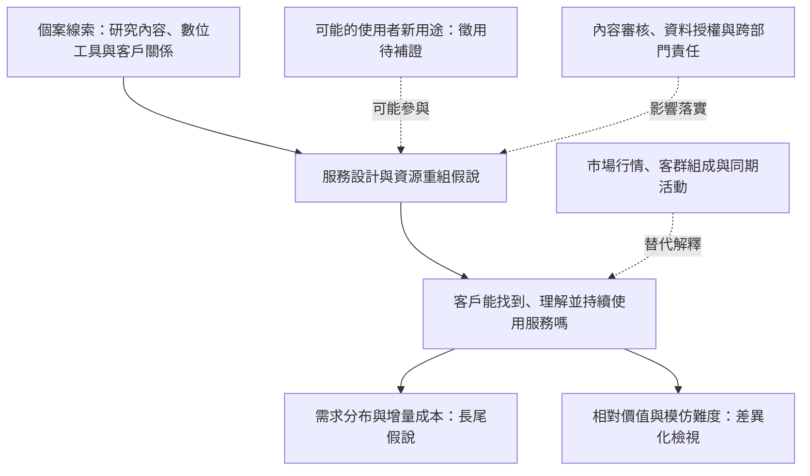

# 永豐金證券數位轉型：理論與個案之間的連結

**Information Systems Case Analysis · Theory–Evidence Mapping · Digital Transformation**

[English](README.en.md) · [原始簡報，32 頁](presentation/original-case-presentation.pdf) · [個案分析](docs/case-study.md) · [理論與證據對照](docs/theory-case-bridge.md) · [驗證設計](docs/validation-design.md)

這份個案研究探討：**永豐金證券如何重組研究內容、數位工具與客戶服務，形成有價值且可能持續的服務差異？**

我以原團隊簡報為起點，將服務與技術描述連結到技術徵用、長尾、資源重組及差異化等分析視角，進一步追問：每個概念究竟解釋了什麼？現有線索是否足夠？什麼證據會讓解釋成立，或需要修正？

**作品整理：李奕成 Eason，2026 年 10 月。原始個案為團隊成果。** [貢獻與歸屬](docs/contribution.md) 說明歷史團隊資料、本次再分析及 AI 協作的界線。

## 原始簡報完整保留

[公開的 PDF](presentation/original-case-presentation.pdf) 就是使用者提供的原始 32 頁簡報，沒有重製、改字、刪頁或重新排版。其 SHA-256 與原始檔一致。**本儲存庫沒有收錄 AI 重製簡報。**

深入分析另存為文字文件，讀者可以將新增解釋與原稿逐頁對照。課程教材不在公開儲存庫中。[來源紀錄](docs/provenance.md)

## 分析深度體現在哪裡？

| 分析能力 | 在本案中的具體做法 | 閱讀入口 |
| --- | --- | --- |
| 問題界定 | 把「數位轉型創造優勢」收斂為研究內容重用、服務成本與組織協作問題 | [個案問題與分析單位](docs/case-study.md#研究問題與分析單位) |
| 概念辨識 | 區分借鏡同業與技術徵用、擴大客群與長尾需求、成立部門與資源重組 | [概念與證據的配對](docs/theory-case-bridge.md) |
| 理論整合 | 將使用實踐、服務設計、需求分布及競爭結果分層，避免將四個概念當成必經階段 | [整合理論框架](docs/theory-case-bridge.md#整合理論框架) |
| 批判判讀 | 檢查金控與券商的分析層次差異，處理替代解釋及資料不足 | [證據限制](docs/case-study.md#證據限制與替代解釋) |
| 管理推論 | 從機制假說推導試點選擇、協作責任與評估條件 | [管理意涵](docs/managerial-implications.md) |
| 可檢驗性 | 寫出條件式命題，列出支持證據、削弱訊號與量測方法 | [命題與驗證設計](docs/validation-design.md) |

## 核心判斷：四個視角回答不同層次的問題

| 視角 | 想回答的問題 | 個案線索 | 本案的判斷 |
| --- | --- | --- | --- |
| 技術徵用 Appropriation | 既有技術的用途如何改變？ | 原稿提到借鏡富途與整合式平台 | 能支持模式學習，但缺少原用途、調整行動與新實踐，徵用尚待確認 |
| 資源重組 Recombination | 哪些資源以新的方式形成服務？ | 研究內容、既有系統、新部門及客戶資源衝突 | 是連結個案與組織設計的主要解釋方向，仍需實際流程證據 |
| 長尾 Long Tail | 分散需求能否透過數位供給累積價值？ | 研究內容由法人延伸到更廣泛客群 | 是需求與成本的假說，不能只由會員數增加判定成立 |
| 差異化與資源基礎觀點 | 客戶是否重視差異，競爭者是否容易複製？ | 原稿將差異化作為轉型目的 | 功能上線與持續優勢之間仍有距離，需要客戶、競品與能力累積證據 |

理論定義與原始學術來源見 [參考文獻](docs/references.md)。上表的個案判斷是本次再分析，不是文獻對永豐金證券的實證結論。



這是一個**有待檢驗的分析框架**。箭頭表示待驗證的機制關係，不是已重建的企業時序或已證實的因果效果。長尾與差異化可各自成立或不成立，技術徵用也不是資源重組的必要前提。

## 一條可以追溯的推論

1. **個案線索 E07**：原稿第 29 頁記載，研究內容由法人客戶延伸到更廣泛客群。
2. **理論問題**：這是否產生可持續服務的小眾需求，或只是增加大眾通路？
3. **命題 P2**：若內容可重用且小眾內容容易被找到，分散題材的持續使用可能增加，同時仍需檢查增量成本。
4. **削弱訊號**：使用始終集中少數熱門題材，或審核與支援成本抵銷新增價值。
5. **管理意涵**：試點應觀察題材分布、重複使用與成本，不能只用總會員數宣布長尾成功。

完整路徑見 [理論與個案對照](docs/theory-case-bridge.md)；原稿頁碼見 [證據清單](evidence/evidence-register.csv)。

## 文件與證據

- [個案分析](docs/case-study.md)：商業情境、分析單位、主要推論與替代解釋。
- [理論與證據對照](docs/theory-case-bridge.md)：概念邊界、跨層次整合與逐項解釋。
- [命題與驗證設計](docs/validation-design.md)：P1–P4、觀察指標、比較設計與反證條件。
- [管理意涵](docs/managerial-implications.md)：方案取捨、協作安排與試點決策。
- [證據清單](evidence/evidence-register.csv) 與 [主張清單](evidence/claims-register.csv)：區分原稿記載、分析假說與建議。
- [來源與限制](docs/provenance.md)、[貢獻說明](docs/contribution.md) 與 [參考文獻](docs/references.md)。

## 資料與結論的範圍

本案是基於歷史團隊簡報的回溯性再分析。原稿包含 2023 年資料，但未交代完整研究期間。本次沒有新增企業訪談、客戶紀錄或營運實驗，亦未查核 2026 年企業現況，因此不宣稱已證實長尾收益、因果效果或持續競爭優勢。

內容完整性可在本機檢查：

```bash
python3 scripts/verify_portfolio.py
```

這項檢查核對檔案、連結、證據代碼與原簡報雜湊，不構成商業結論或理論命題的實證驗證。
